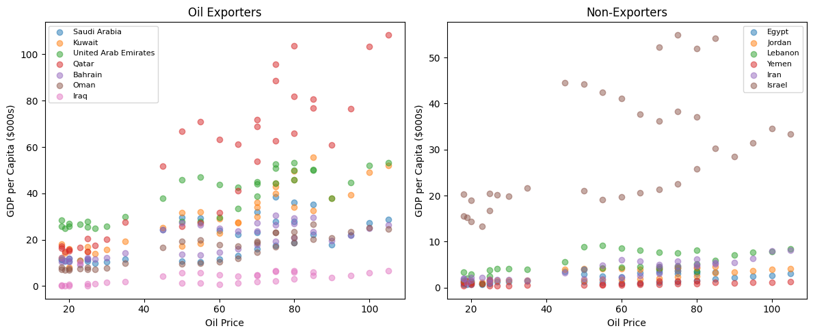
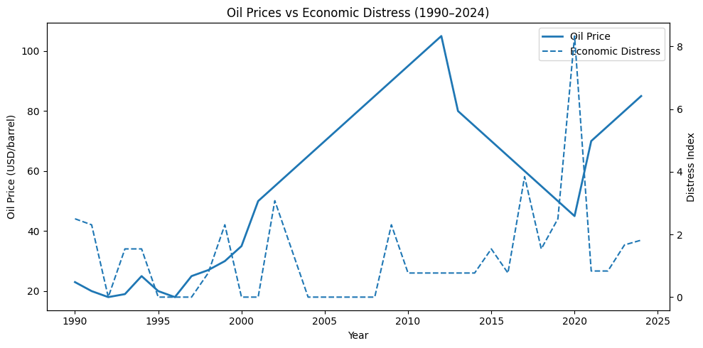
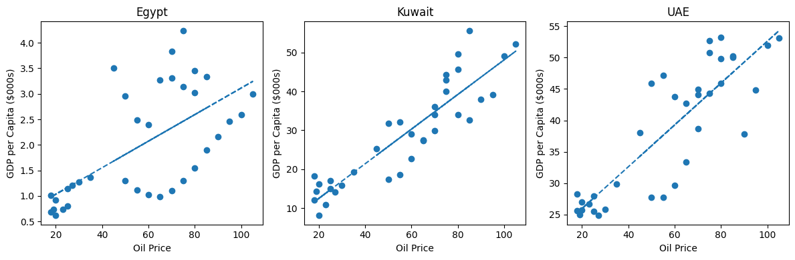

# Oil Prices and Economic Outcomes in the Middle East (1990–2024)

How closely does the Brent crude oil price track GDP per capita in Middle Eastern economies? Does that relationship differ between oil exporters and other countries?

This analysis uses Python (pandas, NumPy, SciPy, Matplotlib) on country-level economic data from 1990 to 2024. The full notebook output is in [`oil_change_analysis.html`](oil_change_analysis.html). Download it and open it in a browser to view it.

## Key findings

1. **GDP per capita in Gulf exporters moves closely with oil prices.** Pearson correlation (r) between the Brent price and GDP per capita: Kuwait 0.90, UAE 0.86, Saudi Arabia 0.68. All three are statistically significant (p < 0.001).
2. **Some non-exporters also move with oil prices.** Egypt's correlation is 0.64 (p < 0.001). Yemen's is 0.30 and is not statistically significant (p = 0.12).
3. **Across all country-years, the exporter group shows a stronger relationship than the comparison group:** r = 0.46 for exporters versus r = 0.19 for the comparison group.

## Method

1. Took one Brent oil price per year and built per-country tables of GDP per capita and annual GDP growth.
2. Computed the Pearson correlation between oil price and GDP per capita for Saudi Arabia, Kuwait, the UAE, Yemen, and Egypt.
3. Compared two pooled groups:
   - Exporters: Saudi Arabia, Kuwait, UAE, Qatar, Bahrain, Oman, Iraq.
   - Comparison group: Egypt, Jordan, Lebanon, Yemen, Iran, Israel.
4. Built a simple **distress index**: the share of countries with negative GDP growth in a given year, scaled from 0 to 10. Plotted it against the oil price.

## Limitations

- Correlation does not show that oil prices cause GDP changes.
- Oil prices and GDP per capita are both in current US dollars. Both tend to rise over time, which can inflate correlations. Inflation-adjusted values or year-over-year changes would give a stricter test.
- Pooled group correlations mix countries with very different income levels.
- Iran is a major oil exporter but is in the comparison group here. Moving it to the exporter group would change the group results.
- In this dataset, the oil price rises in a straight line from 2001 to 2012. This suggests some years are interpolated rather than observed.

## Data

The analysis reads `Middle_East_Economic_Data_1990_2024_with_Oil.csv`. The file includes country, year, GDP, GDP growth, GDP per capita, trade, foreign direct investment, and Brent oil price columns. The dataset is not included in this repository.
